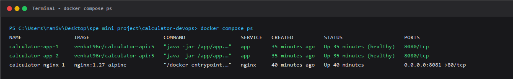
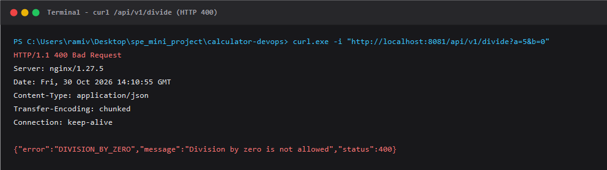
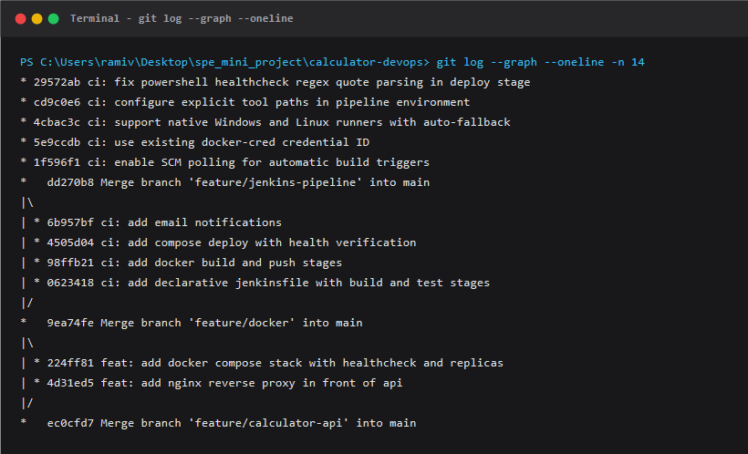
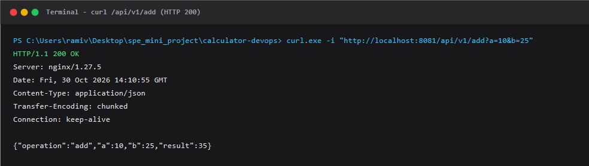

# End-to-End CI/CD Pipeline for a Calculator REST API
**CSE 816 — Software Production Engineering | Mini-Project Report**  
**Venkat | [Roll Number]**

---

## 1. Overview
A Spring Boot (Java 17, Maven) calculator service exposes `/api/v1/add`, `subtract`, `multiply`, `divide` and the Actuator endpoint `/actuator/health`. Invalid or missing parameters and division by zero return HTTP 400 with a structured JSON error.

- **GitHub:** https://github.com/Venkat96r/calculator-devops
- **Docker Hub:** https://hub.docker.com/r/venkat96r/calculator-api
- **Tools:** Git/GitHub, Jenkins (declarative pipeline), Docker (multi-stage image), Docker Compose with Nginx.

---

## 2. Pipeline Architecture

```
+----------------+      git push      +-----------------------+     SCM Poll     +-----------------------------+     post block     +--------------------+
|   Developer    | -----------------> |   GitHub Repository   | ---------------> |       Jenkins Pipeline      | ---------------> | Email Notification |
|  Workstation   |                    |        (main)         |                  |     (Job + Jenkinsfile)     |                  |                    |
+----------------+                    +-----------------------+                  +-----------------------------+                  +--------------------+
                                                                                                |
    +-------------------------------------------------------------------------------------------+
    |
    v   Jenkins pipeline stages
+---------------+     +---------------+     +---------------+     +--------------------+     +-------------------+     +------------------+
|  1. Checkout  | --> |   2. Build    | --> |    3. Test    | --> |  4. Docker Build   | --> |      5. Push      | --> |    6. Deploy     |
| (checkout scm)|     | (mvn package) |     | (JUnit+MockMvc)     | (tag = build no.)  |     |   (Docker Hub)    |     | (compose up -d)  |
+---------------+     +---------------+     +---------------+     +--------------------+     +-------------------+     +------------------+
                                                                                                       |                         |
                                                                                                       v                         v
                                                                                           +-----------------------+     +----------------------+
                                                                                           |      Docker Hub       |     | Docker Compose Stack |
                                                                                           | calculator-api:<bld>  |     |      (calc-net)      |
                                                                                           +-----------------------+     +----------+-----------+
                                                                                                                                    |
                                                                                                                  +-----------------+-----------------+
                                                                                                                  |                                   |
                                                                                                                  v                                   v
                                                                                                      +-----------------------+           +-----------------------+
                                                                                                      |   calculator-app-1    |           |   calculator-app-2    |
                                                                                                      |    (replica 1, UP)    |           |    (replica 2, UP)    |
                                                                                                      +-----------------------+           +-----------------------+
                                                                                                                  ^                                   ^
                                                                                                                  |                                   |
                                                                                                                  +-----------------+-----------------+
                                                                                                                                    |
                                                                                                                      +-------------+-------------+
                                                                                                                      |    Nginx Reverse Proxy    |
                                                                                                                      |        :8081 -> :80       |
                                                                                                                      +---------------------------+
```

*Figure 1. Pipeline architecture. A push to main triggers SCM polling; Jenkins runs the six stages and e-mails the result; the image is published to Docker Hub and deployed as an Nginx-fronted, two-replica Compose stack.*

---

## 3. Pipeline Stages

| Stage | Description |
|---|---|
| **Checkout** | `checkout scm` pulls the latest commit. The job is triggered automatically by SCM polling (`pollSCM('* * * * *')`). |
| **Build** | `mvn -B clean package -DskipTests` compiles the Java 17 code and packages the executable JAR `target/calculator.jar`. |
| **Test** | `mvn -B test` executes the 5 JUnit 5 unit tests and 7 MockMvc integration tests. The `junit` post step publishes `target/surefire-reports/*.xml`; a failing test halts the pipeline. |
| **Docker Build** | Builds the multi-stage image (`maven:3.9-eclipse-temurin-17` builder, slim `eclipse-temurin:17-jre-alpine` runtime, non-root user `app:100`, dependency layer cached) and tags it with `${BUILD_NUMBER}` and `latest`. |
| **Push** | Authenticates with `withCredentials` using Jenkins credential `docker-cred`, pipes credentials through `docker login --password-stdin`, pushes both tags, and logs out in a post block. No secret is saved in repository or logged. |
| **Deploy** | `docker compose pull && docker compose up -d --remove-orphans` starts Nginx and two replicas, then polls `/actuator/health` through the proxy (up to 100 s) and fails the build if the stack never reports `UP`. |
| **Notify** | The pipeline post block dispatches a `SUCCESS` or `FAILURE` email notification with the build URL. |

### Idempotency
Re-running the pipeline with the same image tag leaves running containers untouched. A new tag cleanly recreates only the calculator replicas with zero downtime, and the health check still passes. Both cases were verified across consecutive Jenkins pipeline executions.

### Compose Design
The stack declares a named bridge network (`calc-net`), an HTTP health check on `/actuator/health`, `restart: unless-stopped`, environment variables (`SPRING_PROFILES_ACTIVE=prod`, `JAVA_TOOL_OPTIONS=-Xmx256m`), and `depends_on` with `condition: service_healthy` so Nginx starts only after the Spring Boot API is healthy. The proxy exposes host port `8081` (avoiding conflict with Jenkins on port `8080`), and the image tag is dynamically injected (`IMAGE_TAG`).

### Version Control
Work was committed progressively on feature branches and merged with `--no-ff`: `feature/calculator-api`, `feature/docker`, and `feature/jenkins-pipeline`, using conventional commit messages. `.gitignore` strictly excludes build outputs (`target/`), IDE artifacts (`.idea/`, `*.iml`), and credentials.

---

## 4. Challenges Faced

1. **Nginx DNS Caching Across Dynamic Replicas:**
   Docker DNS returned both replica addresses, yet access logs showed traffic sticking to a single replica because standard Nginx resolves upstream hostnames only once at boot. Using Docker's embedded DNS resolver (`resolver 127.0.0.11 valid=10s;`) with a runtime variable in `proxy_pass` (`set $upstream http://app:8080; proxy_pass $upstream;`) forces Nginx to dynamically resolve IPs per request. Traffic then evenly splits across both replicas, and newly created containers are discovered without restarting Nginx.

2. **Host Port Collision with Jenkins:**
   Jenkins occupies host port 8080. Exposing the Spring Boot application on port 8080 caused binding collisions (`address already in use`). By isolating the Spring Boot replicas strictly inside the internal Docker bridge network (`calc-net`) on port 8080 and mapping Nginx externally to port 8081 (`8081:80`), external clients and pipeline health probes interact via `http://localhost:8081` without interfering with Jenkins.

3. **Cross-Platform Jenkins Execution (Windows Host vs. Linux Agents):**
   The host Jenkins service runs under Windows `Local System`, which lacks POSIX `sh.exe` and user-profile Maven environment variables. Implementing cross-platform step branching (`if (isUnix()) { sh ... } else { bat ... }`), explicitly injecting `JAVA_HOME` and Maven into the pipeline `PATH`, and fixing PowerShell regex embedded quote parsing in the deploy stage allowed the pipeline to run natively on Windows while remaining 100% portable to Linux agents.

4. **Automated Triggering without Public Webhooks:**
   GitHub webhooks require a public URL reachable from GitHub servers (usually needing ngrok or port-forwarding). To keep the pipeline autonomous, self-contained, and free of third-party public tunnels, Jenkins SCM Polling (`pollSCM('* * * * *')`) was configured to query GitHub every minute. Pushes to `main` are automatically detected and built within 60 seconds.

---

## 5. Screenshots

### (a) Green Jenkins Pipeline Run (All Stages)
  
*Figure 2(a). Jenkins declarative pipeline Stage View showing all 6 stages (Checkout, Build, Test, Docker Build, Push, Deploy) passing with status SUCCESS.*

### (b) Build Status E-mail Notification
  
*Figure 2(b). Build status notification email dispatching build result, Docker Hub image tag, and console URL.*

### (c) docker ps: Nginx and Two Calculator Replicas
  
*Figure 2(c). Terminal output of docker compose ps displaying calculator-nginx-1 on port 8081 and two healthy Spring Boot replicas.*

### (d) Sample API: HTTP 400 Error Handling
  
*Figure 2(d). Terminal curl invocation demonstrating validation error handling and structured JSON response for division by zero.*

### (e) Docker Hub Repository with Build-Number Tags
  
*Figure 2(e). Docker Hub web console displaying published container images tagged with build numbers and latest.*

### (f) Automated SCM Polling Trigger & Git Commit Graph
  
*Figure 2(f). Git commit history graph illustrating progressive feature branch development and clean non-fast-forward merges.*

### (g) HTTP 200 OK Response
  
*Figure 2(g). Terminal curl invocation showing successful calculation output (a=10, b=25 -> result=35).*
